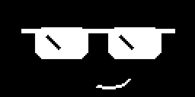
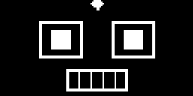
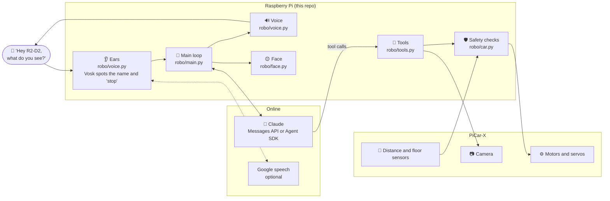
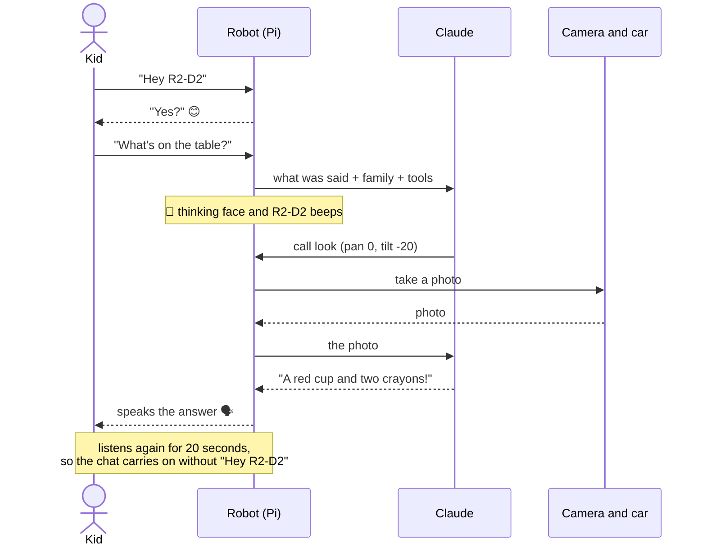
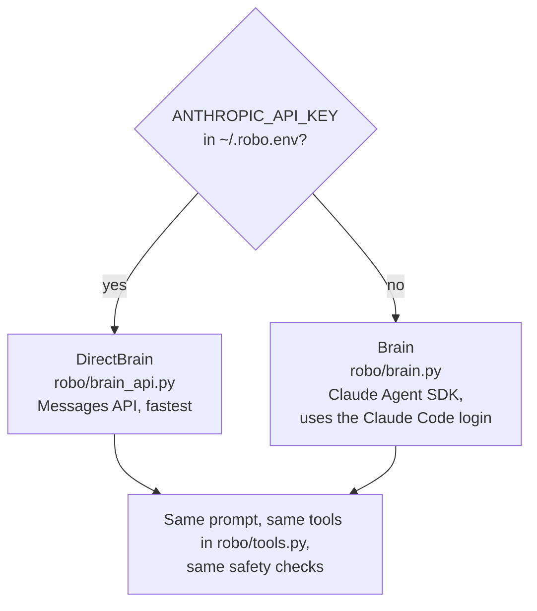
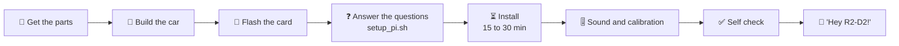
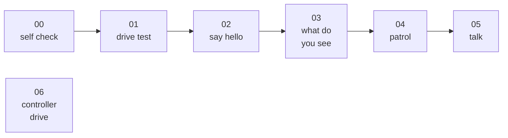
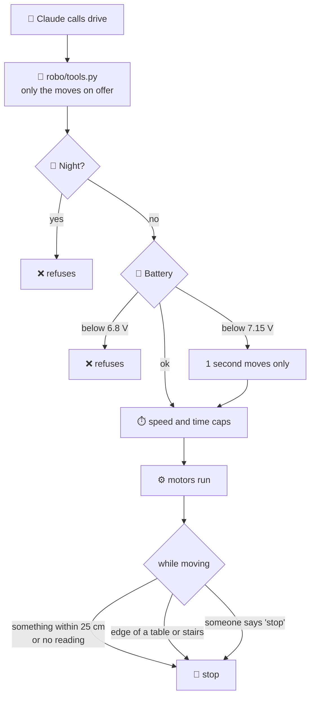
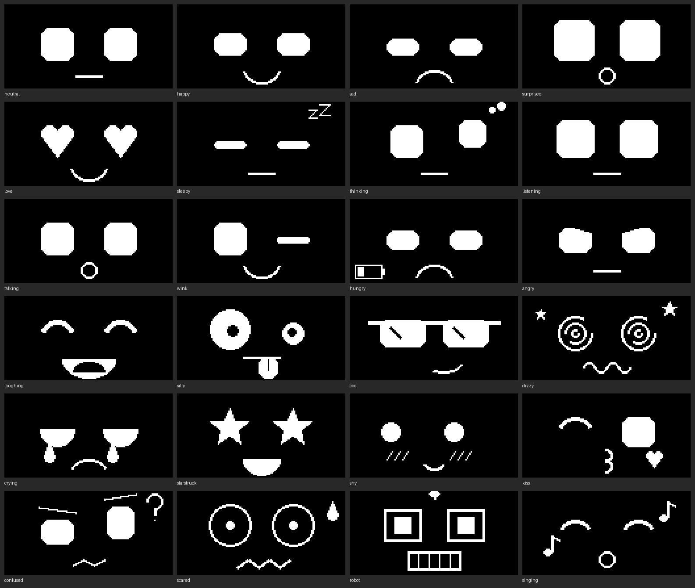
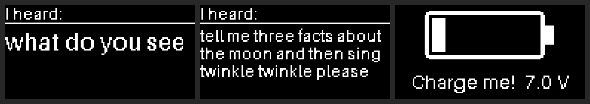

<h1 align="center">R2-D2: a little robot with a Claude brain</h1>

<p align="center">
  
  
  
  
  
  
</p>

<p align="center">
  A Raspberry Pi 4 and a SunFounder PiCar-X that listens for <b>"Hey R2-D2"</b>,
  looks through its camera, drives around, plays games and talks back,
  with Claude deciding what to do.
</p>

<p align="center">
  <a href="https://github.com/praneeth-goparaju/r2d2-claude-robot/actions/workflows/tests.yml"></a>
  <a href="LICENSE"></a>
  
  
  
</p>

<p align="center">
  <a href="docs/SETUP.md"><b>Build your own</b></a> ·
  <a href="#how-it-works">How it works</a> ·
  <a href="#try-it-without-a-car">Try it without a car</a> ·
  <a href="#safety">Safety</a> ·
  <a href="#what-it-can-do">What it can do</a>
</p>

---

## What it can do

| 🗣️ Talk | 👀 See | 🚗 Drive | 🎲 Play |
|---|---|---|---|
| Wakes up on "Hey R2-D2", answers in English or German, keeps a conversation going, searches the web for news | Takes a photo whenever a question is about what is around it, and answers from what it sees | Moves in short, capped steps and stops by itself for walls, table edges and a flat battery | Freeze Dance, Copy My Dance, Name That Tune, Hide and Seek, Simon Says, Color Hunt, I spy, quizzes, stories |

| 😊 Faces | 🎵 Sounds | 🎭 Characters | 🏠 Family |
|---|---|---|---|
| 24 faces on a small OLED screen; it blinks, follows the camera and moves its mouth while talking | Songs, dances, tricks, drumrolls and fanfares, and silly voices from giant to chipmunk | Can play WALL-E, EVE, R2-D2 or a silly Dalek-style villain | Knows who lives in the house, sings on birthdays, keeps a diary and tells the best bits at bedtime |

## How it works

A small Python program on the Pi does the listening, speaking and driving.
Claude does the thinking: it gets what you said, a description of the
household, and a set of **tools** it may call, such as `look`, `drive`,
`dance` or `play_sound`. Claude never touches a motor directly; every tool
goes through the same safety checks.



### One question, start to finish



### Two brains, one set of tools



`ROBO_BRAIN=api|agent|auto` in `~/.robo.env` forces a choice. A new tool is
written once and both brains can use it.

**No extra cost on a Max plan.** Max plans include a monthly API credit that
covers the Messages API and the Agent SDK. Put an API key from the Console
organisation linked to the plan in `~/.robo.env` and the robot spends that
credit. `MAX_TURNS_PER_DAY` keeps it from being used up.

## Build your own

<table>
<tr>
<td width="50%" valign="top">

**You need**

- SunFounder PiCar-X 2.0 kit
- Raspberry Pi 4 and a 32 GB microSD card
- A USB microphone if your Robot HAT is V4 (V5 has one)
- An Anthropic API key, or a Claude account
- Optional: Google Cloud key, OLED screen, Xbox controller

</td>
<td width="50%" valign="top">

**Then**

```bash
git clone https://github.com/praneeth-goparaju/r2d2-claude-robot.git ~/robo-picarx
cd ~/robo-picarx && bash setup_pi.sh
```

The script asks how you want the robot first, then installs everything.

</td>
</tr>
</table>



The questions the script asks:

| Question | Choices |
|---|---|
| Claude, the brain | an API key, or the Claude Code login |
| Voice and ears | a Google Cloud key (quicker, better with children), or free on the Pi |
| Language | English or German |
| Robot HAT | V4 (USB microphone) or V5 (built-in microphone) |
| Town | for the weather and pollen; the coordinates are looked up for you |
| Household | names, who they are, birthdays; or keep the example family |
| Start at boot | yes or no |

Everything step by step: **[docs/SETUP.md](docs/SETUP.md)**. Change an answer
later with `python3 setup_questions.py`.

## Try it without a car

`--mock` replaces the car, camera and microphone with fakes, and `--keyboard`
lets you type instead of speaking. Needs Claude Code logged in.

```bash
git clone https://github.com/praneeth-goparaju/r2d2-claude-robot.git && cd r2d2-claude-robot
python3 -m venv .venv && source .venv/bin/activate
pip install -r requirements.txt
python programs/01_drive_test.py --mock
python programs/05_talk.py --mock --keyboard
```

Put any room photo at `tests/mock_view.jpg` and that is what Claude "sees".
Both flags work on the Pi too, which is how you test the brain without the car
driving off the table.

## Programs

Numbered in the order to try them; each one proves one more part works.



| Program | What it does | Needs |
|---|---|---|
| `00_self_check.py` | Tests battery, sensors, camera, ears, internet, voice, temperature and disk, and says what works | car |
| `01_drive_test.py` | Forward, back, steer, pan the camera, print the distance | car |
| `02_say_hello.py` | Speaks, then repeats what you say | car, mic |
| `03_what_do_you_see.py` | One photo, one Claude call, a spoken description. The first brain test | car, camera, Claude |
| `04_patrol.py` | Roams for a while with obstacle and edge stops, then Claude sums up what it saw | car, camera, Claude |
| `05_talk.py` | The whole robot: "Hey R2-D2", then talk | everything |
| `06_controller_drive.py` | Drive with an Xbox controller over Bluetooth, no Claude. The talking robot can be driven with it too | car, controller |

On the Pi, run them with `sudo -E python3 programs/<name>`: sound on the Robot
HAT needs root, and `-E` keeps your settings.

## Safety

The limits live in the code, not in Claude's instructions, so Claude cannot
talk its way past them.



- Speed is capped at `MAX_SPEED` (40 of 100) and one move at `MAX_MOVE_SECONDS` (3).
- There is no rear sensor, so reversing is capped harder: `REVERSE_MAX_SPEED` (30) and `REVERSE_MAX_SECONDS` (1.5).
- Moving forward, it checks the distance sensor all the time and stops below `STOP_DISTANCE_CM` (25). No reading at all counts as an obstacle.
- Any move stops when the floor sensor sees an edge.
- "Stop" (or the push-to-talk button, or B on the controller) stops the motors at once, without waiting for Claude.
- Night mode (20:00 to 07:00): a quieter voice, one soft sentence per reply, and no driving.
- The battery limits are checked in `robo/car.py`, not left to Claude.
- The camera turns at most ±35° (`CAM_PAN_LIMIT`), so the servo is never pushed past its stop.
- `MAX_TURNS_PER_DAY` (120) stops the answers after that many in a day, so the Claude credit lasts.
- The camera's live web view has no password, so it stays off unless you switch it on.
- Old photos, voice clips and diary days are deleted automatically.
- The distance sensor misses thin things like legs, toys and cushions. The edge stop and the speed and time caps are the safety net for those.

## Personality

<details>
<summary><b>All 24 faces and the screen notices</b></summary>
<br>


</details>

- **Your household** in `robo/family.yaml`: who lives here, house rules and the games it offers.
- **A new name.** "Can I call you Ziggy?" and after a yes the wake word is "Hey Ziggy", even after a restart.
- **Its day.** "How was your day?" or "good night" and it tells the three best moments from its diary.
- **How it works.** "How do your eyes work?" and it explains itself truthfully, for a 5-year-old, a 10-year-old or a grown-up.
- **Are you okay?** It runs a self check and says what works and what needs help.
- **Tricks:** nod, shake, wiggle, peekaboo, bow, twirl, look around. It answers yes/no questions with a nod or a shake.
- **Music games:** Freeze Dance (it stops the music and checks the camera for anyone still moving), Copy My Dance and Name That Tune.
- **Camera games:** Hide and Seek, Simon Says and Color Hunt.
- **Characters:** WALL-E, EVE, R2-D2 or a silly Dalek-style villain, each with its own voice.
- **Birthdays:** on the day it sings Happy Birthday once and shows hearts.
- **Idle curiosity:** left alone, it looks around, nods or hums now and then. Never at night.

## Google voice and ears (optional)

With a Google Cloud key the robot speaks with Google's voice and Google writes
down what it is asked: quicker than the Pi and better with children's voices.
Claude stays the brain. Without a key it uses a free voice and Moonshine on
the Pi. Only speech meant for the robot goes to Google: what follows its name,
the answer after "Yes?", and what is said during a conversation.

<details>
<summary><b>Getting a Google key</b></summary>

1. At https://console.cloud.google.com create a project (e.g. "robo") and add a
   billing account. The voice is free up to 1 million characters a month; the
   ears cost about $0.016 to $0.024 per minute of speech, a few dollars a month.
   Set a budget alert under Billing → Budgets if you like.
2. Under APIs & Services → Library switch on **Cloud Text-to-Speech API** and
   **Cloud Speech-to-Text API**.
3. Under APIs & Services → Credentials → Create credentials → API key. Edit the
   key: under "API restrictions" pick only those two APIs.
4. On the Pi, run `python3 setup_questions.py` and paste the key at question 2,
   then restart the robot (`systemctl --user restart robo`). The self check at
   start says "Google speech: key works", or what Google objected to.

The voice is `GOOGLE_VOICE` in `robo/config.py`; `VOICE_ENGINE = "edge"` and
`LISTEN_ENGINE = "moonshine"` switch back to the free ones.
</details>

## What is where

```
robo/
├── main.py           the loop: wake word, listen, think, act, speak
├── brain_api.py      Claude through the Messages API (the default brain)
├── brain.py          the instructions for Claude, and the Agent SDK brain
├── tools.py          everything Claude may do: look, drive, dance, play_sound ...
├── car.py            the safety checks around the PiCar-X; MockCar for a computer
├── camera.py         snapshot(): one JPEG from the camera
├── voice.py          ears (Vosk, Moonshine, Google) and voice (Google, Piper, Edge, espeak-ng)
├── face.py           eyes and mouth on the 0.96 inch OLED
├── games.py          the music and camera games
├── characters.py     WALL-E, EVE, R2-D2 and the Dalek-style villain
├── config.py         name, personality, voice, language, model, safety limits
└── family.example.yaml   the example household; yours goes in family.yaml
programs/             00 to 06, in the order to try them
docs/SETUP.md         the step-by-step build and install guide
setup_pi.sh           the install on the Pi; setup_questions.py asks the questions
robo.service          start at boot as root; robo-user.service as your user
tests/                python -m unittest; lint with ruff check .
```

## Make it yours

Two things are personal and stay on your Pi, never in git.
`python3 setup_questions.py` asks for both, or by hand:

1. **Your household:** `cp robo/family.example.yaml robo/family.yaml` and edit it.
   Without it the robot uses the example family.
2. **Where you live,** for the weather. Add to `~/.robo.env`:
   ```
   ROBO_PLACE=Your Town
   ROBO_LAT=52.52
   ROBO_LON=13.41
   ```
   Without these lines it reports the weather for Berlin.

Everything else, from the robot's name and personality to its speed limits, is
in `robo/config.py`, each setting explained where it is set.

## Licence

MIT, see [LICENSE](LICENSE).
